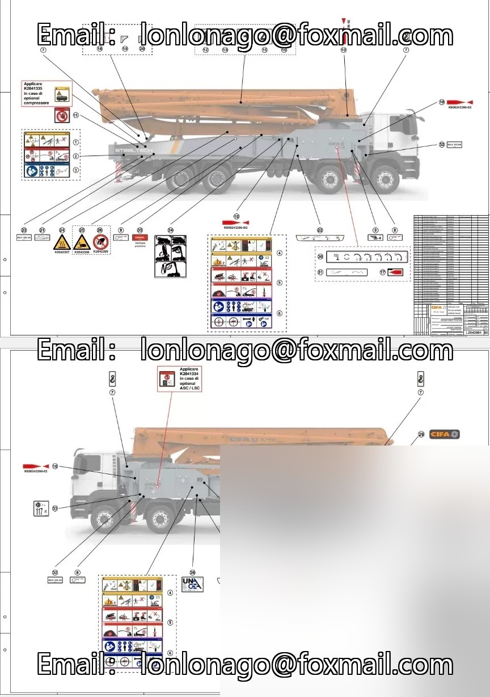
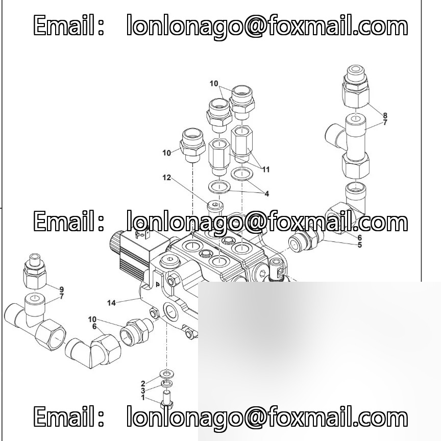
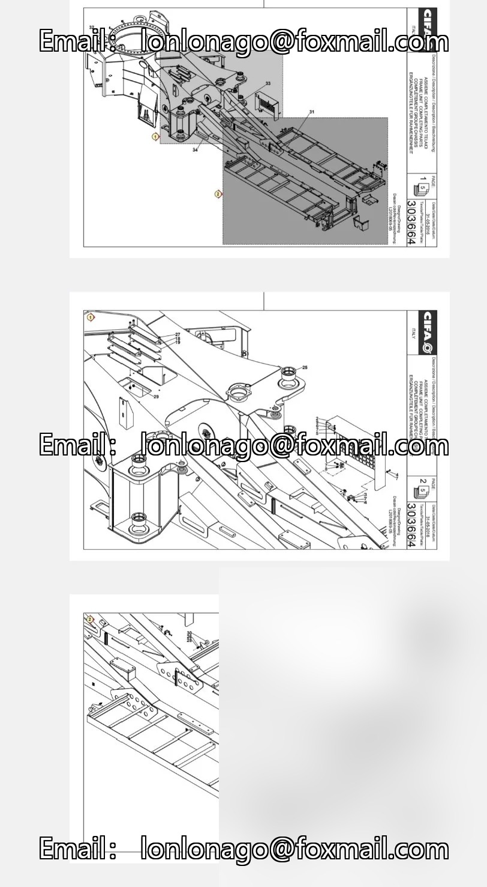
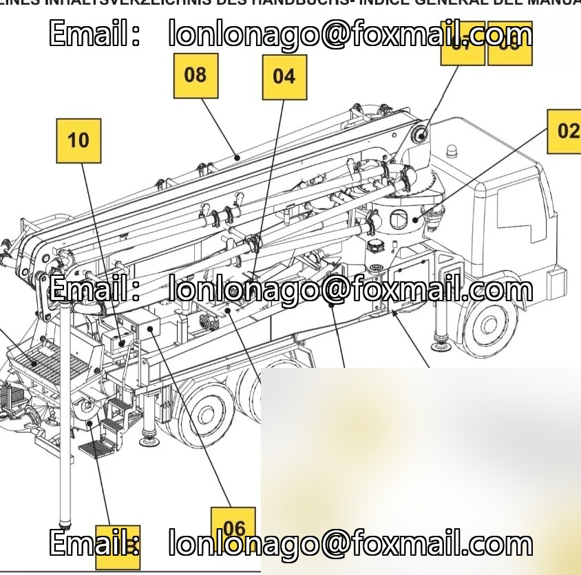

# CIFA K48-HP1606H concrete pump truck spare part manual (Spar)

## Body

CIFA K48-HP1606H Concrete Pumping Truck Spare Parts Manual (Spare Parts List)
PDF , 360 pages
Released on March 11, 2021, suitable for querying and ordering spare parts.
Need to order directly, contact privately for any issues.
734346879-3
CIFA K48-HP1606H is a 48-meter-class concrete pumping truck specially designed for urban high-rise buildings and complex construction sites. It focuses on "compact body + large boom," being able to easily unfold and operate within a very small footprint, and is the main model for casting bridges pierings, basements, and high-rise residential buildings.

The manual covers spare parts for the CIFA K48-HP1606H concrete pump truck, in PDF format with 360 pages and a release date of March 11, 2021.

<!-- AI_ENRICHED -->

## Images

## Payment

Here is a pay link on Stripe ( https://buy.stripe.com/3cs8yP7sY87d0vu9AB ). Please contact me lonlonago@foxmail.com after funding $89, and I will send you a complete data files , thank you!

